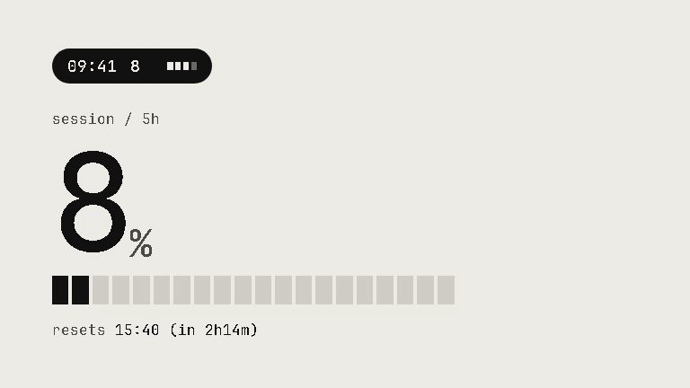
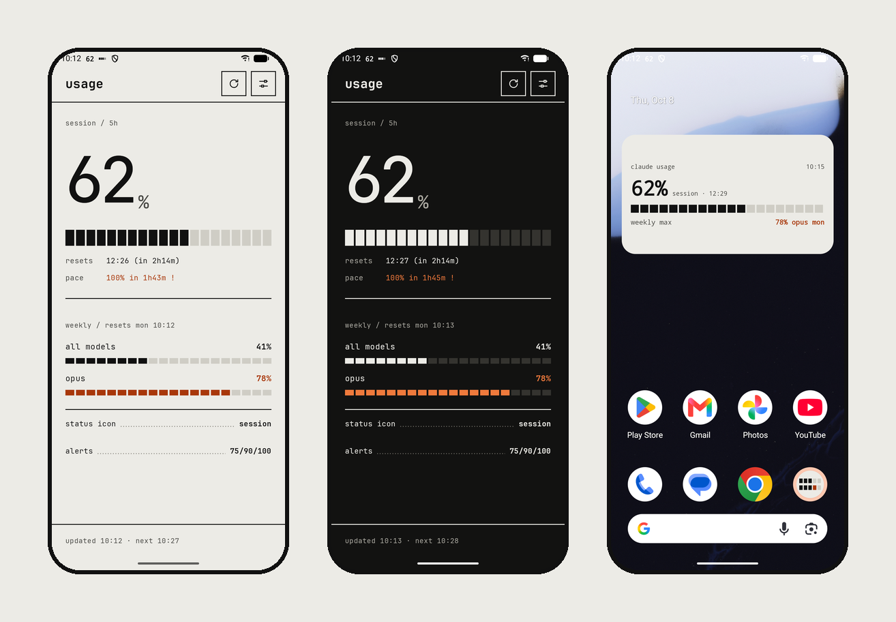
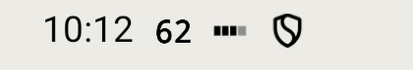
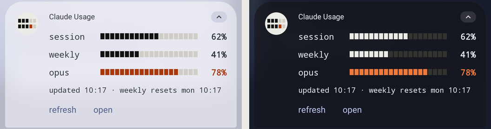
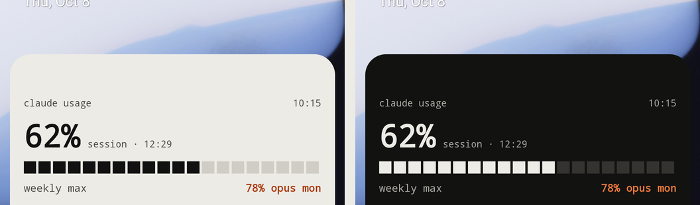
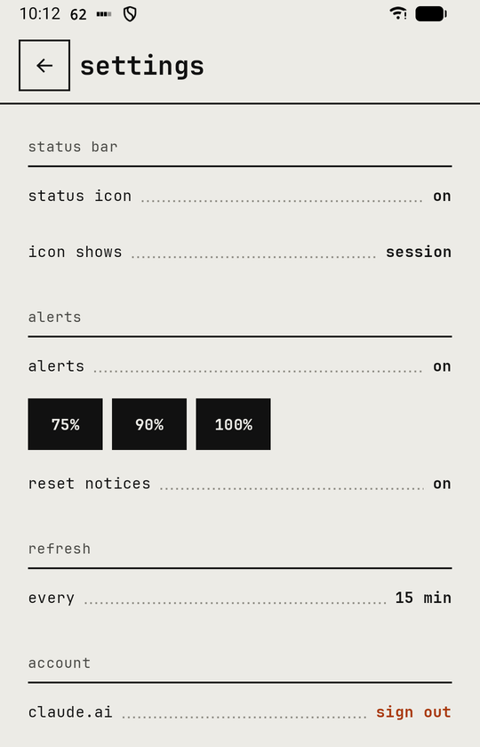

  

<h1 align="center">Claude Usage for Android</h1>

  Your Claude session and weekly limits in the status bar, the notification shade and a home-screen widget.

  <a href="https://github.com/drknowhow/claude-usage-android/releases/latest/download/claude-usage.apk"><b>Download the APK</b></a>
  ·
  <a href="https://github.com/drknowhow/claude-usage-android/releases">All releases</a>
  ·
  <a href="https://github.com/sponsors/drknowhow">Sponsor</a>

  
  
  

> Unofficial. Not made by, endorsed by, or affiliated with Anthropic.

## What it shows

### Status bar

The session percent sits next to the clock all day. At the limit it turns into `!!`.
Settings can make it follow the weekly limit instead, or whichever of the two is higher.

On Android 16 phones that allow Live Updates (Pixel, stock Android) it shows as a chip
with the percent. On older versions it is the notification icon. OxygenOS (OnePlus)
replaces notification icons with app icons and doesn't let other apps post Live Updates,
so there the status bar only shows the app icon; the shade card and widget still work.

### Shade card

Pull down the shade for one bar per limit (session, weekly, and any per-model weekly
cap), the next reset, and a refresh button. The bars follow the shade's light or dark
theme. Where the Live Update chip is in use, Android draws the card itself: one bar for
the limit in the status bar, the others as text.

### Widget

Session percent with its reset time, plus the tightest weekly limit. Resizes from 2×1 to
4×2.

### Alerts

A notification when a limit passes 75%, 90% or 100%, once per window. When a window that
alerted resets, you get a short notice. Each threshold can be switched off.

### The app

Large numbers, a 20-cell bar per limit, reset countdowns, and a pace estimate ("100% in
1h43m") once it has a few readings. Pull to refresh.

## Install

1. On your phone, download [`claude-usage.apk`](https://github.com/drknowhow/claude-usage-android/releases/latest/download/claude-usage.apk) and open it. Android asks you to allow installs from your browser or file manager.
2. Open **Claude Usage**, allow notifications, and tap **sign in**.
3. Sign in to claude.ai with your email and the code it sends. Google blocks its sign-in
   inside apps, so use the email option even if your account normally uses Google.

Readings refresh every 15 minutes by default (30 or 60 in settings). Android can delay
background work while the phone is idle, so the footer shows when the last reading
arrived.

Every release is signed with the same key, so a new APK installs over the old one.

## How it works

The app opens claude.ai's own login page in a WebView. After you sign in, the session
cookie stays in that WebView's storage on your phone. Each refresh sends it to
`claude.ai/api/organizations/{org}/usage` and reads the limits from the reply. The app
talks to nothing except claude.ai and has no analytics.

That endpoint is not a public API. If claude.ai changes it, the app keeps the last good
reading, marks it stale and backs off until an update fixes it.

## Build from source

    ./gradlew :app:testDebugUnitTest :app:assembleDebug
    adb install -r app/build/outputs/apk/debug/app-debug.apk

You need the Android SDK (`sdk.dir` in `local.properties`) and JDK 17 or newer. The app
is Kotlin and Jetpack Compose, with Glance for the widget and WorkManager for refreshes,
and runs on Android 10 (API 29) and up.

Debug builds add **Settings › debug › simulate**, which replaces the network reading with
a percent you pick, so you can try the icon, card, widget and alerts without spending
real usage.

The animation at the top is a [Remotion](https://www.remotion.dev/) composition in
[`promo/`](promo). Run `npm install`, then `npm run gif` to rewrite `docs/images/demo.gif`.

## Support

If the app saves you from a surprise rate limit, you can
[sponsor the work](https://github.com/sponsors/drknowhow). Bugs and ideas go in
[issues](https://github.com/drknowhow/claude-usage-android/issues).

## Notes for Android developers

- On Android 16 the live notification asks for promotion (`android.requestPromotedOngoing`
  plus `setShortCriticalText`) with a segmented `ProgressStyle`, which gives the status-bar
  chip. Promotion forbids custom views, so the custom shade card is the fallback when
  `canPostPromotedNotifications()` is false.
- The live notification uses a default-importance channel with sound and vibration off.
  At low importance it lands in the shade's "Silent" group, and the status bar hides
  those icons.
- Alerts post under a group summary. Otherwise Android 16 bundles them with the live
  notification under the app icon, which hides the percent.
- The shade card's bars are white masks tinted with separate light and dark colours
  (`RemoteViews.setColorInt`), and the widget's bars are Glance boxes, so both follow a
  theme change that happens after they were drawn.
